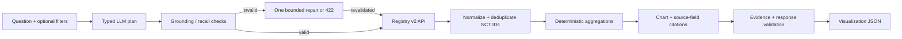

# Clinical Trials AI Agent

[](https://github.com/rafigmammadov/clinical-trials-ai-agent/actions/workflows/ci.yml)

**Natural-language clinical-trial analytics, returned as evidence-backed visualization JSON.**

Ask about trial activity, phases, geography, sponsors, interventions, enrollment, or relationships. A constrained language model interprets the question; deterministic Python code retrieves, counts, and cites records from the [ClinicalTrials.gov API v2](https://clinicaltrials.gov/data-api/api). The response is designed for a frontend renderer—there is no frontend dependency.

## What it does

| Question family | Visualization | Semantics |
|---|---|---|
| Trial starts by year | Time series | Distinct NCT IDs by study start year |
| Phases, status, interventions, sponsors, countries | Bar chart | Distinct studies per category |
| Two drugs by phase | Grouped bars | Independently searched, possibly overlapping cohorts |
| Sponsors ↔ drugs; drug co-occurrence | Network graph | Distinct-study edge weights and two-sided evidence |
| Enrollment distribution | Histogram | Studies grouped by enrollment count |
| Enrollment vs. start year | Scatter plot | One point per eligible study |

Country counts mean **studies with at least one listed site** in that country, not site counts. Multiple phases, countries, and drug cohorts can overlap. Chart limits and source-search limits are disclosed separately. The [full API contract](docs/api.md) documents every supported input, visualization, and error response.

## How it works



The model **does not** generate trial counts, NCT IDs, clinical conclusions, executable code, or API URLs. It produces a constrained `QueryPlan`. The application checks for invented and omitted filters, validates explicit dates, and optionally repairs a rejected plan **once**. A repaired plan must pass the same checks; no invalid plan reaches the registry. Unsupported requests fail closed.

## Quick start

Requires Python 3.11+ and internet access for live analyses.

```bash
git clone https://github.com/rafigmammadov/clinical-trials-ai-agent.git
cd clinical-trials-ai-agent
python3 -m venv .venv
source .venv/bin/activate
python -m pip install -r requirements.txt
cp .env.example .env
```

Set `OPENAI_API_KEY` in `.env` to your **own active key** (do not commit it). Start the server:

```bash
python -m uvicorn app.main:app --reload
```

Interactive API docs: [http://127.0.0.1:8000/docs](http://127.0.0.1:8000/docs). The versioned endpoint is `POST /api/v1/analyze`:

```bash
curl --fail-with-body -sS http://127.0.0.1:8000/api/v1/analyze \
  -H 'Content-Type: application/json' \
  -d '{
    "query": "How many melanoma trials started each year since 2023?",
    "condition": "melanoma",
    "start_year": 2023,
    "max_studies": 1500
  }' | python -m json.tool
```

The server also exposes `GET /health` and `GET /api/v1/capabilities`. For deterministic, **limited** testing without an API key, set `PLANNER_MODE=rules`; that mode is not a substitute for the LLM planner.

## Response contract

Every successful response has two top-level objects:

- **`visualization`**: `type`, `title`, `encoding`, and renderable `data` (rows, or `nodes`/`edges` for networks).
- **`meta`**: resolved `query_plan`, applied `filters`, record counts, source details, completeness flags, warnings, assumptions, and planning attempts.

The important distinctions are:

| Metadata | Meaning |
|---|---|
| `records_fetched` | Distinct NCT IDs returned by the registry searches |
| `records_used` | Distinct studies remaining after local filters |
| `records_visualized` | Distinct studies represented in displayed chart data |
| `complete` | Registry candidate retrieval is complete within the search semantics |
| `visualization_truncated` | Some chart categories or edges were hidden for readability |
| `planner_attempts` | One normal structured plan, or two with a bounded correction |

Each datum or graph edge reports `citation_count`, `citations_complete`, and capped NCT-level citations with exact source field paths and values. Network edges cite **both endpoints**. An independent source-evidence check validates displayed excerpts against normalized records before returning an analysis. The count of contributing records is not necessarily the number of citations included in the response.

A `drug_match_mode` of `registered_name` verifies names and `otherNames` aliases listed under **DRUG** interventions in retrieved records. The default `registry_text` preserves wider registry search matching. Neither mode is a clinical ontology or guaranteed to find every relevant study.

## Five real examples

These files are generated using the live API, not fabricated sample counts. They are snapshots and may change as the registry updates.

| Example question | Saved JSON |
|---|---|
| Niemann-Pick type C starts since 2018 | [Trend](examples/time_trend.json) |
| Fabry disease trials by phase | [Phases](examples/phase_distribution.json) |
| Recruiting Wilson disease trials by country | [Geography](examples/geography.json) |
| Fabry disease sponsor–drug relationships | [Network](examples/network.json) |
| Ivacaftor versus lumacaftor by phase | [Comparison](examples/comparison.json) |

Regenerate and validate them with the API running:

```bash
python scripts/generate_examples.py --max-studies 1500 --strict-comparison
python -m scripts.verify_examples
```

A full registry retrieval can still produce a truncated **network visualization**. Both facts are recorded independently. The release script requires all five validated JSON files.

## Verification and release

```bash
python -m pytest -q
python -m evals.run --mode validate
python -m evals.identity
python -m evals.grounding
python -m evals.recall
python -m scripts.verify_examples
bash scripts/package_release.sh
python -m scripts.audit_archive --inspect dist/clinical-trials-ai-agent.zip
```

Offline tests use synthetic fixtures and mocked providers; they do not claim live-model or clinical search accuracy. Optional **billable** evaluations assess the actual model:

```bash
python -m evals.run --mode live --limit 10 --output evals/reports/planner.json
python -m evals.run --mode guarded --limit 10 --output evals/reports/guarded.json
```

`guarded` tests planning, validation, and at most one repair **without retrieving registry data**. See [verification](docs/verification.md) for the quality gates and the [evaluation notes](evals/README.md) for metric denominators.

## Design boundaries

- **Accuracy over apparent completeness.** Partial registry retrieval, missing study fields, and display truncation are reported; text-search matches are not automatically proven drug identity.
- **Simple deployment.** One FastAPI process with pooled HTTP clients, bounded upstream retries, no persistence, queues, vector databases, or orchestration framework.
- **Security.** No authentication or per-user rate limiting is included. Run on localhost; a public deployment needs access controls, quotas, HTTPS and operational review. Never place credentials in a repository or log. See [security](SECURITY.md).
- **Limitations.** Some complex multi-condition, negative-filter, relative-time, or ambiguous clinical-entity requests are rejected. ClinicalTrials.gov data can be incomplete or updated; no patient-level claims, treatment recommendations, or medical efficacy inference are provided.

For architectural tradeoffs and field-level counting rules, read [architecture](docs/architecture.md). The application version (`1.0.0`) is separate from the `/api/v1` contract path. No open-source license has been granted by this repository unless a license file is added.

**AI-assisted development.** ChatGPT/OpenAI tools were used extensively to draft, revise, and test implementation and documentation. Engineering choices emphasized typed plans, deterministic data processing, source citations, and executable regression tests. The author has run live API/model checks and reviewed generated outputs; test fixtures, synthetic benchmarks, and the external live checks are distinguished in the documentation. This project does not claim a formal security audit or clinical validation.
