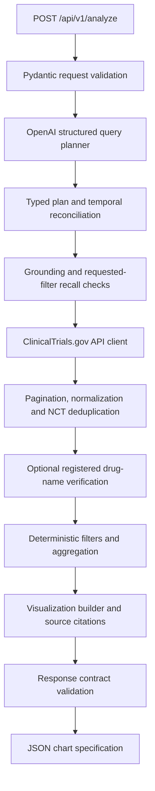

# Clinical Trials AI Agent

A FastAPI service that turns natural-language questions about clinical studies into evidence-backed, renderer-ready visualization JSON. A language model interprets the request; application code retrieves study records from [ClinicalTrials.gov](https://clinicaltrials.gov/data-api/api) and performs the calculations.

The API returns chart encodings, aggregated values, NCT-level source evidence, and explicit retrieval and visualization completeness metadata. It does not produce clinical advice and does not include a frontend.

## Architecture



`app/agent/` owns planning and orchestration; `app/services/` handles the registry integration, normalized study model, and optional registered-name matching; `app/visualizations/` calculates the chart data; `app/schemas/` validates inputs, plans and outputs. The API layer does not calculate study counts. The OpenAI client is reused for the lifetime of the application process and closed on shutdown.

The model cannot choose arbitrary network URLs, execute generated code, or supply study counts. It produces an allowlisted, typed `QueryPlan` that the application independently validates. A deterministic evidence guard also rejects certain model-added filters that were not named in the question; rejected plans never reach the registry. This is a conservative lexical check, not clinical ontology resolution. The numbers and citations originate from normalized registry records. We deliberately use no general-purpose agent framework: a small, inspectable workflow makes data lineage and failure modes easier to reason about.

See [architecture and counting semantics](docs/architecture.md), [query-filter grounding](docs/agent_grounding.md), [plan recall](docs/plan_recall.md), and [design decisions](docs/DECISIONS.md).

## Quick start

Requirements: Python 3.11 or newer; network access to the ClinicalTrials.gov API; an authorized OpenAI API key for `PLANNER_MODE=openai`. ClinicalTrials.gov does not require a key.

```bash
git clone https://github.com/rafigmammadov/clinical-trials-ai-agent.git
cd clinical-trials-ai-agent
python3 -m venv .venv
source .venv/bin/activate
python -m pip install -r requirements.txt
cp .env.example .env
```

Edit `.env` to insert a newly provisioned API key. Never commit a key or paste one into issues, logs, or chat. The example configuration is a template, not a secret store. If the key is missing, health and documentation remain available but LLM-backed analysis returns HTTP 503. For an offline rule-based smoke check, set `PLANNER_MODE=rules` and restart the application; that limited planner is not equivalent to the LLM.

```bash
python -m uvicorn app.main:app --reload
```

Open <http://127.0.0.1:8000/docs> for the generated OpenAPI interface. Production deployments must use an appropriate process manager and add access controls, quotas and monitoring; `--reload` is for development only.

## Configuration

| Variable | Default | Meaning |
| --- | --- | --- |
| `OPENAI_API_KEY` | Empty | Required for LLM-backed analysis; never logged or committed |
| `OPENAI_MODEL` | `gpt-4.1-mini` | Structured planning model (must be permitted by your API project) |
| `PLANNER_MODE` | `openai` | `openai` or limited `rules` test mode |
| `CLINICALTRIALS_API_URL` | `https://clinicaltrials.gov/api/v2` | Registry API base URL; HTTPS required except local loopback testing |
| `CLINICALTRIALS_TIMEOUT_SECONDS` | `20` | HTTPX timeout for each registry request (0.1–120 seconds) |

`get_settings()` caches settings in-process. Restart the application after changing `.env`. Dependencies use bounded version ranges, not a cross-platform lockfile. The CI workflow checks supported Python versions; a successful test on one machine is not a full compatibility guarantee.

## API

| Method | Path | Purpose |
| --- | --- | --- |
| GET | `/health` | Application liveness; does not verify upstream availability |
| GET | `/api/v1/capabilities` | Supported query intents |
| POST | `/api/v1/analyze` | Interpret, retrieve, analyze and return one visualization |

All HTTP responses include `X-Request-ID` (server-generated) and `X-Process-Time-Ms`. Request logs contain request IDs, HTTP paths, status codes and elapsed time—not prompts, payloads or API keys.

Example:

```bash
curl --fail-with-body -sS http://127.0.0.1:8000/api/v1/analyze \
  -H 'Content-Type: application/json' \
  -d '{
    "query": "How have melanoma clinical trial starts changed each year since 2023?",
    "condition": "melanoma",
    "start_year": 2023,
    "max_studies": 1500,
    "citation_limit": 5
  }' > /tmp/clinical-trials-response.json

python -m json.tool /tmp/clinical-trials-response.json
```

`query` is required (5–2,000 characters). Optional inputs include `condition`, `drugs`, `sponsor`, `country`, `start_year`, `end_year`, `recruiting_only`, `max_studies` (1–5,000 **per registry search**) and `citation_limit` (0–50 **contributing studies per datum**). Set `drug_match_mode` to `registered_name` to retain only records that explicitly register the requested DRUG name or alias; its default is `registry_text` for backward compatibility. Explicit structured inputs override the corresponding inferred plan fields. A two-drug comparison performs separate searches; its cohorts can overlap. For time-trend questions of the form `since YYYY`, the end year remains open unless the user supplies a closing year. The service discards an unsupported model-inferred end year for this form and reports the correction; unexplained end-year guesses in other forms are rejected instead of silently changing the dataset. Model-added conditions, drugs, sponsors, countries, start years, and recruiting-only restrictions must also have explicit evidence in the question or a typed structured override, otherwise the request fails with HTTP 422. A second check rejects selected high-confidence **omitted requested filters** before retrieval, so a model cannot silently broaden a query by forgetting the disease, date, geography, sponsor, or recruitment constraint. See [plan recall](docs/plan_recall.md).

Expected errors: HTTP 422 for invalid input or unsupported analyses, 502 for registry failures, and 503 for unavailable planning. FastAPI also emits HTTP 422 for invalid JSON schema inputs. These errors do not include provider response bodies or credentials. Full field definitions are in [API contract](docs/api.md) and the live `/docs` interface.

## Supported analyses

| Intent | Output type | Count or relationship |
| --- | --- | --- |
| `time_trend` | `time_series` | Unique NCT records grouped by start year |
| `phase_distribution` | `bar_chart` | Unique studies per phase |
| `intervention_distribution` | `bar_chart` | Unique studies per intervention type |
| `status_distribution` | `bar_chart` | Unique studies per overall study status |
| `sponsor_distribution` | `bar_chart` | Unique studies per lead sponsor |
| `geography` | `bar_chart` | Unique studies with at least one listed study site in a country |
| `drug_comparison` | `grouped_bar_chart` | Phase distribution of two independently searched drug cohorts |
| `sponsor_drug_network` | `network_graph` | Lead sponsor and drug name co-listed in a study |
| `drug_cooccurrence_network` | `network_graph` | Drug names co-listed within one study |
| `enrollment_histogram` | `histogram` | Enrollment count distributions |
| `enrollment_scatter` | `scatter_plot` | Enrollment against study start year |

For drug-restricted analyses, `registry_text` (default) uses the registry search matches; `registered_name` verifies candidate studies against the names and aliases recorded for `DRUG` interventions. The strict mode improves cohort interpretability but cannot guarantee recall of trials absent from the original search. See [registered intervention matching](docs/intervention_identity.md) for the exact policy and evidence fields.

The planner can return `unsupported`; the server responds with HTTP 422 instead of substituting a misleading chart. It is not a medical reasoning or efficacy-analysis service. Complex multi-condition comparisons, patient-level outcomes, and clinical ontology resolution are not implemented.

## Output contract and provenance

Every successful response contains `visualization` and `meta`:

- `visualization.type`, `.title`, `.encoding`, `.data` tell a frontend how to render the result. Ordinary charts contain row arrays; network charts contain `nodes` and `edges`.
- `meta.query_plan` records the interpreted intent and filters; `meta.filters` records the applied query/search policy and `meta.assumptions` describes grouping semantics. `meta.drug_match_mode` exposes the selected intervention-matching policy; strict mode also reports `meta.matched_drug_counts`.
- `meta.records_fetched` counts distinct retrieved NCT IDs; `records_used` counts post-filter records; `records_visualized` counts distinct records supporting displayed rows or edges; `records_not_visualized` reports eligible records omitted from the displayed chart.
- `meta.complete` describes **registry retrieval**; `meta.visualization_truncated` describes **chart display limits**. A complete registry retrieval can still render only the highest-weighted 75 network edges.
- A datum's `citation_count` is the number of contributing studies; the `citations` array may be capped and `citations_complete` indicates whether every contributing study has a citation. Each citation carries an NCT ID, canonical registry link, supporting source field and excerpt. Multi-field evidence is kept on the same NCT citation using `related_field_path` and `related_excerpt`.

In strict drug matching mode, study citations also contain registered name/alias evidence establishing cohort membership. Source values are taken from the registry, not generated by the LLM. `evidence_scope: record_identity_only` flags records without the relevant field value; the NCT link does not prove that a missing field equals a particular category. Invalid channel references and graph edges referring to nonexistent nodes are rejected by the response schema.

A trial can count toward multiple phase buckets or country buckets. The sum of category assignments is therefore not generally the number of distinct studies. Drug comparison cohorts may overlap. These decisions are made explicit in response assumptions. See [data and provenance design](docs/architecture.md).

## Examples

Five example query/result pairs are generated from the live API, and their JSON output is stored at:

- [Annual trends](examples/time_trend.json)
- [Phase distribution](examples/phase_distribution.json)
- [Recruiting studies by country](examples/geography.json)
- [Sponsor–drug graph](examples/network.json)
- [Drug comparison](examples/comparison.json)

The registry updates over time; study counts and cited records are snapshots, not constants. Example generation requires a running server, a configured LLM, network access, and may use billable model calls.

```bash
python scripts/generate_examples.py --max-studies 1500
python -m scripts.verify_examples

# To regenerate comparison.json using verified registered DRUG names/aliases:
python scripts/generate_examples.py --max-studies 1500 --strict-comparison
```

The verifier is offline: it checks stored JSON structure, counts, evidence references and completeness metadata. It is not a substitute for independently checking sample study fields against the registry.

## Verification and evaluation

```bash
python -m pytest -q
python -m compileall -q app tests scripts evals
python -m evals.run --mode validate
python -m evals.identity
python -m evals.grounding
python -m evals.recall
python -m scripts.verify_examples
```

The filter-recall guard has an independent 74-case synthetic omission benchmark (`python -m evals.recall`), distinct from the live planner recall metric. The filter-grounding validator has a separate, deterministic 54-case synthetic decision benchmark (`python -m evals.grounding`). Its 54 labels are not measurements of live model accuracy. The identity matcher also has a 24-case, hand-labeled **synthetic** evaluation (`python -m evals.identity`). It does not measure registry search recall or live-model accuracy. The offline tests use deterministic fixtures and mocked HTTP interactions. They cover query contracts, pagination, retries, failure injection, deduplication, visualization invariants and response metadata. The test suite does **not** demonstrate live-model accuracy or guarantee that public registry search terminology perfectly matches a clinical ontology.

For a live smoke test, start Uvicorn in another terminal and run `bash scripts/smoke.sh`. Its low record limit intentionally generates partial results and is not a population estimate.

The 50-case planner benchmark uses labeled, independently asserted expectations. Schema validation requires no API calls. Live evaluation is opt-in and billable:

```bash
python -m evals.run --mode live --limit 10 --output evals/reports/planner-10.json
```

Reports include overall intent accuracy, annotated field-extraction accuracy, and the recall of positively labeled requested constraints, with category-level results. This new `requested_filter_recall` metric is `null` when there are no positive labeled assertions. When a category has no filter assertions, its filter accuracy is `null`, not 100%. Live observations should be inspected before generalizing beyond the benchmark. See [evaluation methodology](evals/README.md).

The service reports the source-defined release version in `/health`; this version is distinct from the stable `/api/v1` HTTP contract.

## Security and operational boundaries

The development API does not include authentication, user quotas, or infrastructure-level abuse protection; do not deploy it publicly without adding these controls. Input lengths and retrieval limits are bounded, registry requests have timeouts and retry limits, and untrusted user text cannot supply code or arbitrary outbound URLs. Responses expose no OpenAI credentials and provider errors are mapped to constrained messages. See [security notes](SECURITY.md).

ClinicalTrials.gov searches are term-based. The opt-in registered-name match checks only names/aliases included in returned records; it is not comprehensive clinical terminology resolution. Drug names are not resolved to RxNorm identities and disease names are not mapped to a clinical ontology. Conservative lexical guards can reject clinical synonyms, unrecognized acronyms, or relative dates; the new recall guard recognizes selected explicit constraints but cannot detect every omitted filter or guarantee semantic completeness. Study-wide recruiting status is not site-level recruiting status. Some start dates are estimated or partially specified; enrollment can be anticipated rather than actual. The service does not measure therapeutic effectiveness. Higher fidelity terminology, richer outcome analysis, caching and production controls remain future work.

## Maintainer workflow

The source uses a small-layer architecture rather than distributed services. Changes should include a focused regression test, a documented reason, and a passing offline suite. The repository follows [Conventional Commits](https://www.conventionalcommits.org/en/v1.0.0/), for example `fix(charts): preserve scatter provenance` or `test(api): validate response invariants`. See [developer workflow](docs/DEVELOPMENT.md), [release checks](docs/QUALITY_GATE.md) and [unreleased changes](CHANGELOG.md).

To create a source-only ZIP after validating real examples:

```bash
bash scripts/package_release.sh
python -m scripts.audit_archive --inspect dist/clinical-trials-ai-agent.zip
```

The scanner rejects known secret patterns and unexpected paths, but cannot prove secrets are absent from Git history. Keep `.env` and local evaluation reports outside version control.

### AI-assisted development and license

AI assistants have been used to help draft and revise implementation and documentation. The code has undergone offline regression tests and user-run live API checks; these are distinct forms of verification. Neither AI assistance nor passing tests constitutes an independent clinical or security audit.

No software license has been selected in this repository. Public source visibility alone does not grant reuse or redistribution rights. Contact the repository owner about licensing and contributions.
