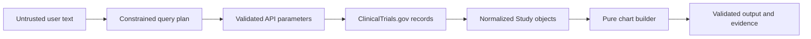

# Architecture and data semantics

## Execution and trust boundaries

The API accepts a user question plus optional explicit filters. The OpenAI planner returns a Pydantic-validated `QueryPlan`; no executable instructions or arbitrary URL fields are part of the plan. `AnalysisService` verifies supported intents, the number of comparison drug terms and date bounds before triggering registry requests. Explicit structured request filters take precedence over inferred terms.

ClinicalTrials.gov is the sole source of clinical-study facts. `ClinicalTrialsClient` compiles allowlisted plan fields into registry query parameters, retrieves pages, normalizes study records and deduplicates by NCT ID. HTTP 408/429 and selected 5xx errors use bounded retry/backoff. Connection pools are reused at application scope. A malformed study is skipped with a warning and prevents `complete=true`.

The deterministic visualization builder operates on normalized immutable `Study` instances. It groups by distinct NCT ID, constructs frontend fields, and attaches field-level citations. It never calls the LLM. `AnalyzeResponse` validates channel encodings, graph references, item counts and basic record-accounting invariants before serialization.

## Cardinality and completeness

- `records_fetched`: distinct NCT identifiers retrieved by the API adapter; for a comparison, distinct IDs in the union of the two search results.
- `records_used`: distinct studies remaining after local filters.
- `records_visualized`: distinct NCT IDs represented by a displayed chart bucket, point, or network edge.
- `records_not_visualized`: records used minus records visualized (missing chart dimensions or display caps).
- `total_matches`: registry-reported match count when it is meaningful for a single search; two drug cohorts use `cohort_matches` instead.
- `complete`: no known missing registry pages or malformed omitted records and, when available, retrieved unique study count matches the reported total.
- `visualization_truncated`: output intentionally hides categories or network edges beyond the visualization limit, independent of registry completeness.

A phase-1/phase-2 study appears in both buckets. A multi-site study can appear once per country. A trial matching two drug text searches may appear in both cohorts. Membership sums should not be interpreted as disjoint trial counts.

A sponsor–drug edge weight counts unique studies containing both a lead sponsor name and a registered drug intervention name. A drug–drug edge counts unique studies listing both drugs; it does not imply an administered combination or causal relationship. Each edge citation includes evidence for both endpoints.

Time-series counts use `protocolSection.statusModule.startDateStruct.date`, not first posting or last update. Missing/invalid dates are excluded. Known future full dates and future months are excluded when an end year is not requested, but ambiguous or estimated dates are not proof of a completed start.

## Data and evidence limitations

Searches by intervention, condition and sponsor use ClinicalTrials.gov text search semantics. They do not constitute RxNorm/MeSH identity resolution, and the local sponsor filter specifically checks lead sponsor names. `recruiting_only` uses study-level overall status, not a location-level assertion.

For a plotted point or edge, `citation_count` represents distinct contributing NCT IDs, not source-field count. Citations can be capped without changing the aggregate; `citations_complete=false` indicates omitted evidence links. A scatter point uses one study citation containing both start-date and enrollment-field evidence. `record_identity_only` is used when a datum represents a source field that is absent.

## Runtime lifecycle and observability

Uvicorn starts a FastAPI lifespan that owns a pooled HTTPX client for the registry and, if configured, an OpenAI planner client. Both are closed at shutdown. Every HTTP response includes a generated `X-Request-ID` and elapsed-process-time header. Application-level request logs do not store user questions, study bodies, or credentials.

There is intentionally no persistence layer, cache, authentication, multi-agent framework, distributed queue, or hosted dashboard. Those should be added only after measuring a concrete need and defining an operational threat model.
