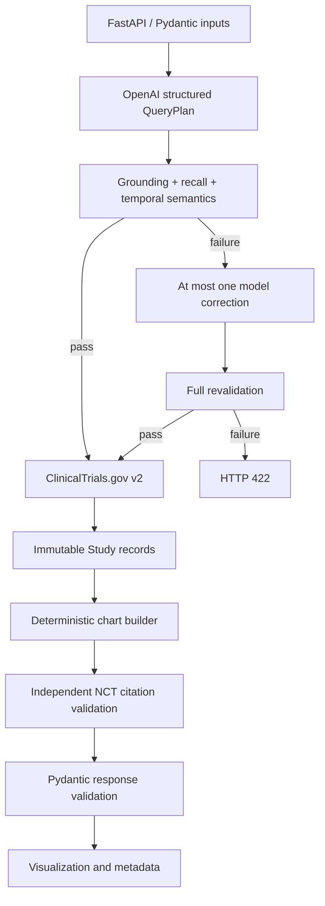

# Architecture and data semantics

The service has five boundaries: HTTP validation, constrained model planning, deterministic plan checks, registry retrieval, and deterministic chart production. `app/main.py` wires shared HTTP clients into the application lifespan; `AnalysisService` coordinates the business flow without embedding registry or model SDK calls in route handlers.

## Planner trust boundary

`app/agent/planner.py` uses OpenAI's structured output parser with a strict `QueryPlan`: only intent and known filters. Query-plan values cannot carry executable code, network destinations, or numerical trial totals. `grounding.py` flags model-added terms without explicit question evidence. `recall.py` compares high-confidence requested constraints to the plan and fails closed on recognizable unsupported negative filters. Explicit typed API inputs override corresponding inferred fields.

When a structured plan fails a representable-input check, the OpenAI planner may receive **one** correction request. The correction is treated as untrusted and must pass the same validation. Requests requiring unsupported exclusions and initial `unsupported` classifications are not automatically repaired. `planner_attempts` and `planner_repaired` make model-call amplification visible. Rule-based offline planning does not implement repair.

The lexical checks are intentionally not medical entity recognition; they can miss rare synonyms or reject ambiguous wording. Prefer explicit structured input for precise analysis. A plan's valid JSON shape does not establish semantic accuracy.

## Registry and clinical semantics

`ClinicalTrialsClient` only constructs known ClinicalTrials.gov v2 query parameters. It applies timeout and bounded 408/429/5xx retries, respects bounded `Retry-After`, follows `nextPageToken`, detects cursor cycles, and tolerates isolated empty pages while refusing repeated no-progress pages. `max_studies` caps each search. Malformed records are skipped with incomplete-result disclosure rather than treated as true population totals.

`normalize_study` creates immutable records keyed by `NCT` identifier. The application uses the registry's study **start date**, not first posting or last update, for time trends. Missing dates do not contribute; dates may be *estimated* rather than actual starts. Recruitment status is the **overall study status**, not a site's current recruitment. Lead sponsor is not equivalent to collaborators.

| Metric | Counting rule |
|---|---|
| Time trend | One distinct NCT per valid start year |
| Phase distribution | One NCT per phase; multi-phase records contribute to multiple buckets |
| Geography | One NCT per listed country (not number of sites) |
| Drug comparison | Separate cohort searches; one NCT may count for both drugs |
| Sponsor–drug edge | Distinct NCT IDs linking lead sponsor to named DRUG intervention |
| Drug co-occurrence | Distinct NCT IDs listing both drug names; no inferred administered combination |
| Histogram / scatter | Numeric enrollment and any other required observed fields |

`drug_match_mode=registered_name` only retains studies with matching DRUG intervention names or registered aliases. Matching is conservative case/whitespace normalization, **not** molecular equivalence or ontology resolution. This policy cannot recover studies absent from the initial registry search.

## Provenance and display completeness

The visualization builders attach NCT IDs and **verbatim normalized source-field excerpts**. Network edges carry evidence for each endpoint, while scatter points carry date and enrollment from the same study. `app/services/evidence.py` independently verifies all displayed citations and paired fields against the retrieved normalized records. If that verification fails, the endpoint returns an internal integrity error rather than displaying false provenance. This does not cryptographically verify the registry server.

`records_fetched` tracks distinct upstream candidates. `records_used` means candidates surviving filters, and `records_visualized` means contributors to displayed rows or edges. `meta.complete` means candidate registry pagination completed with no known omitted/invalid records; it is separate from `visualization_truncated` (top 25 categories or 75 edges). Capped citations disclose `citation_count` and `citations_complete`.

## Deliberate tradeoffs

- **No agent framework:** one typed planning step with at most one correction is simpler to inspect and test than opaque tools or multi-agent loops.
- **No database/cache:** results reflect the live registry at request time; this trades repeated retrieval for clear freshness semantics.
- **Bounded work:** small chart displays and registry limits constrain response size, with explicit incompleteness metadata rather than invented totals.
- **No public auth:** appropriate for local evaluation, not for an internet-exposed API without deployment-specific protections.

The authoritative HTTP schema is in `app/schemas/api.py`; `/openapi.json` provides the generated machine-readable contract.
